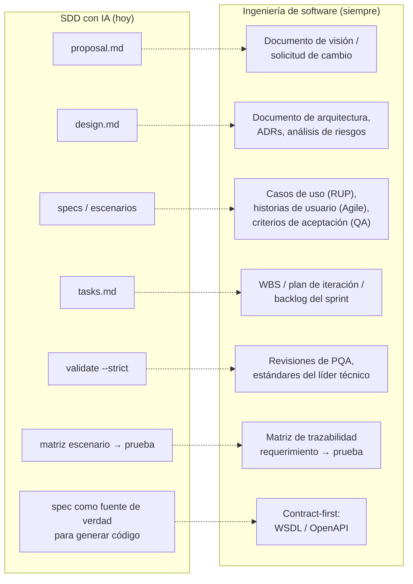
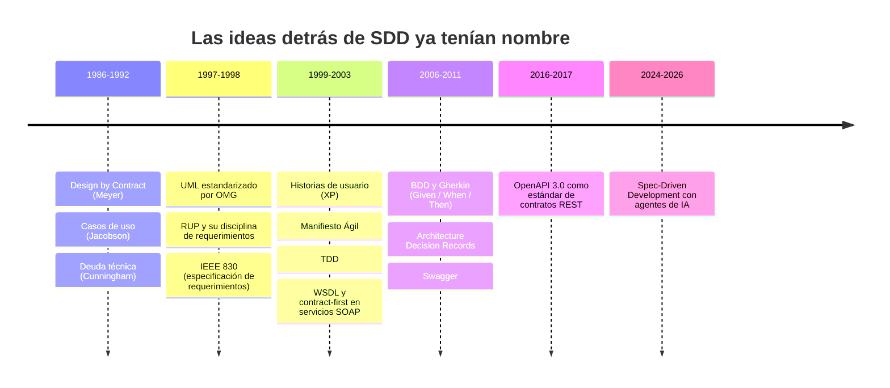
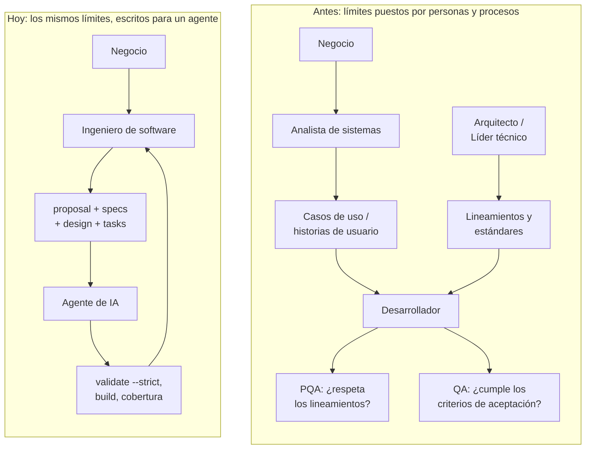
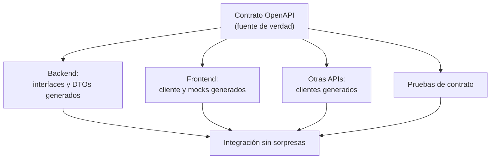
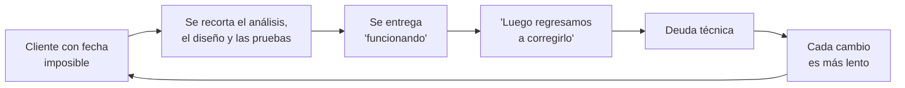

Últimamente es difícil abrir LinkedIn sin encontrar a alguien anunciando que **Spec-Driven Development (SDD)** es "la nueva forma de construir software con IA". Escribe primero la especificación, define los escenarios, documenta las decisiones de diseño, desglosa las tareas, valida contra la spec… y entonces deja que el agente implemente.

Hace poco terminé una prueba de concepto aplicando SDD con **OpenSpec** sobre el refactor de un controlador REST legado en Java/Spring Boot. Funcionó bien, y más adelante cuento los detalles. Pero mientras revisaba el reporte final tuve una sensación muy clara de *déjà vu*:

> Nada de lo que hizo que la POC funcionara es nuevo. Es exactamente lo que, como ingenieros de software, se supone que hacíamos desde hace más de veinte años.

Este artículo no es una crítica a la IA ni a SDD. Es un recordatorio de dónde vienen sus ideas, y por qué eso importa.

---

## Lo que hoy se presenta como novedad

Un flujo típico de SDD con OpenSpec produce, antes de escribir una sola línea de código, artefactos como estos:

- `proposal.md`: qué se quiere cambiar y por qué.
- `design.md`: decisiones técnicas, riesgos, trade-offs y preguntas abiertas.
- `specs/`: requerimientos expresados como escenarios verificables.
- `tasks.md`: el desglose del trabajo en tareas ordenadas.
- `openspec validate --strict`: una verificación de que todo lo anterior es consistente.

Ahora pongamos cada uno al lado de su "antepasado":

Si alguien trabajó en un proyecto con RUP, CMMI o un equipo ágil medianamente serio, reconocerá cada caja de la derecha. Cambió el formato (Markdown en el repositorio en lugar de un documento de Word en un servidor compartido), pero la intención es la misma.

---

## Un poco de memoria histórica

Las prácticas que sostienen a SDD tienen fecha de nacimiento, y ninguna es reciente:

Los **escenarios** de una spec de OpenSpec son, en la práctica, Gherkin con otro nombre. Las **decisiones de diseño con sus trade-offs** son ADRs. La **matriz escenario → prueba** es la matriz de trazabilidad que cualquier auditoría de calidad nos pedía. El **análisis del sistema antes de tocarlo** es literalmente el trabajo que hacía un analista de sistemas.

---

## Los roles que ya ponían límites

Hay un argumento recurrente a favor de SDD: *"la IA alucina, escribe código de más y se sale del diseño; la spec la mantiene en el carril"*.

Es cierto. Pero ese problema no lo inventó la IA. Los desarrolladores humanos también "alucinábamos": agregábamos abstracciones que nadie pidió, duplicábamos componentes que ya existían, o ignorábamos las convenciones del proyecto. Para eso existían roles y procesos concretos:

- **Analistas de sistemas**, que entendían el negocio y el sistema antes de que alguien escribiera código.
- **QA**, que definía y ejecutaba las pruebas de aceptación contra lo acordado.
- **PQA** (en CMMI, *Process and Product Quality Assurance*), que vigilaba que el código y el proceso respetaran los lineamientos: estándares de codificación, estructura, reutilización de componentes.
- **El líder técnico y el arquitecto**, que definían los límites dentro de los cuales se podía implementar.

SDD no agrega un límite nuevo. Toma los límites que antes vivían en la cabeza del arquitecto, en el checklist de PQA y en el plan de pruebas de QA, y los escribe en un formato que un agente puede leer.

---

## Contract-first: la "spec antes que el código" que ya conocíamos

Si hay una práctica que se parece casi uno a uno a SDD, es **contract-first**. Antes con WSDL en los servicios SOAP, y después con OpenAPI en las APIs REST, la regla era clara: **antes de escribir el código de un endpoint, se diseña el contrato**.

En ese contrato se definía todo lo que importa de la interfaz:

- Los DTOs de entrada y salida, con sus tipos, formatos y campos obligatorios.
- Los parámetros de consulta, las variables de path y los encabezados.
- Los códigos de respuesta y la estructura de los errores.
- Los esquemas de seguridad: qué endpoint requiere autenticación y con qué mecanismo.

Y lo más valioso: ese contrato **se compartía con los equipos consumidores** (frontends, apps móviles u otras APIs) para que pudieran avanzar en paralelo con mocks generados a partir de él, sin quedarse detenidos esperando a que el backend terminara.

Compáralo con SDD: una especificación legible por máquina, escrita antes que el código, que sirve como fuente de verdad para generar la implementación y verificarla. Es la misma idea; SDD la extiende de la *interfaz* al *comportamiento*.

En mi POC esto se notó bastante. Parte de la spec eran escenarios como "las claves del contrato están presentes en la respuesta" y "los nombres internos de las entidades no se exponen". Son preocupaciones de contract-first, escritas en formato de escenario para un agente.

¿Y qué pasaba en la práctica? Lo mismo que con todo lo demás. Por la presión de los managers y de los propios stakeholders, la mayoría de los equipos optaba por **code-first**: escribir primero el controlador, anotar las clases y dejar que la herramienta generara la documentación al final. El contrato dejaba de ser un acuerdo de diseño y se convertía en un subproducto de la implementación. Los consumidores esperaban, los DTOs exponían detalles internos y los cambios incompatibles se descubrían en integración.

---

## Entonces, ¿por qué parece novedad?

Porque durante años **no lo hicimos**, o lo hicimos a medias.

Seamos honestos: no todos los equipos seguían estas prácticas. Y los que sí, muchas veces las abandonaban bajo presión. El ciclo era conocido:

La especificación, el diseño explícito y las pruebas de aceptación se percibían como "documentación" y, por lo tanto, como lo primero que se podía sacrificar. El conocimiento que faltaba en el papel lo compensaba el equipo con su experiencia tácita: "ya sabemos cómo funciona esto".

Aquí está, para mí, **lo único genuinamente distinto** con la IA:

1. **El consumidor de la spec ya no es una persona con contexto.** Un agente no tiene conocimiento tácito del proyecto. Si el requerimiento es ambiguo, no lo va a "intuir": va a inventar algo razonable y probablemente incorrecto. La disciplina que antes era recomendable ahora es obligatoria.
2. **El costo de la disciplina bajó.** Escribir el diseño, los escenarios y las pruebas ya no compite tanto contra el tiempo de implementación, porque gran parte de la implementación la hace el agente. El viejo argumento de "no hay tiempo para documentar" pierde fuerza.

Ninguno de los dos puntos es una idea nueva de ingeniería. Es un cambio en la economía de aplicar ideas viejas.

---

## Lo que me enseñó la POC

En la prueba de concepto refactoricé un controlador REST legado (listado paginado y cancelación de registros) siguiendo `proposal.md`, `design.md` y `tasks.md`, en 11 grupos de tareas con un commit por grupo. El resultado técnico fue sólido:

- Build completo en verde con **207 pruebas y 0 fallos**.
- La spec validada en modo estricto.
- **100% de cobertura de líneas** en el controlador refactorizado y en el manejador global de errores.
- **Todos los escenarios de las specs trazados a al menos una prueba**, unitaria o de integración.

Pero lo interesante no son los números, sino *por qué* funcionó y *dónde* hizo falta un ingeniero.

**Lo que funcionó** fue tener, antes de implementar, un diseño con tablas de comportamiento *antes/después* y un mapeo explícito de campos. Los escenarios de la spec se tradujeron casi 1:1 a nombres de prueba, y la matriz de trazabilidad prácticamente se escribió sola. Eso no es mérito de la IA: es mérito de un buen análisis previo, exactamente lo que RUP y BDD prometían.

**Lo que necesitó criterio humano** fue todo lo que el diseño no previó:

- Las coordenadas Maven reales de una dependencia interna no coincidían con lo supuesto en el diseño; hubo que verificarlas leyendo el `.pom` y el JAR local.
- El JDK por defecto del entorno rompía Lombok; hubo que identificar el problema y ejecutar con la versión correcta.
- La infraestructura de pruebas de integración (JNDI simulado) tenía un comportamiento poco documentado que nadie había anticipado.
- Varias **preguntas abiertas del diseño** (¿qué pasa si se cancela un registro ya cancelado? ¿los clientes actuales envían AM/PM en minúsculas?) se decidieron conscientemente como fuera de alcance o como riesgo de despliegue. Esa es una decisión de negocio e ingeniería, no de un agente.

La recomendación que me llevo para próximos proyectos también suena muy "clásica": incluir en el diseño un paso explícito de *verificar las dependencias externas contra el repositorio real antes de implementar*, y documentar el comportamiento de herramientas poco comunes tan pronto se descubren. Eso es gestión de riesgos y análisis de supuestos. Lo hemos hecho siempre; o deberíamos haberlo hecho.

---

## Mi postura

No estoy en contra de la IA ni de SDD. Al contrario: la POC me convenció de que es una forma muy efectiva de trabajar. Lo que cuestiono es el discurso que lo presenta como un descubrimiento.

- **Entender el negocio** siempre fue parte de ser un buen ingeniero de software.
- **Especificar antes de construir** siempre fue la recomendación, desde los casos de uso hasta las historias de usuario.
- **Diseñar el contrato antes que el código** siempre fue la recomendación con contract-first, de WSDL a OpenAPI.
- **Definir cómo se va a verificar** siempre fue trabajo de QA y de la definición de "terminado".
- **Poner límites al código** siempre fue trabajo de PQA, del líder técnico y del arquitecto.

SDD y los agentes de IA son **herramientas que potencian a un ingeniero de software**, no un sustituto de la ingeniería. Si un equipo nunca supo escribir un buen caso de uso o un buen criterio de aceptación, darle un agente no lo va a resolver; le va a permitir producir más rápido un sistema que tampoco entiende.

Quizá el mejor efecto secundario de todo esto sea que la IA nos está obligando a volver a hacer, con seriedad, lo que siempre supimos que había que hacer.

---

*¿Tu equipo seguía estas prácticas antes de la IA, o SDD fue la primera vez que las vieron en serio? Me interesa leer otras experiencias.*
