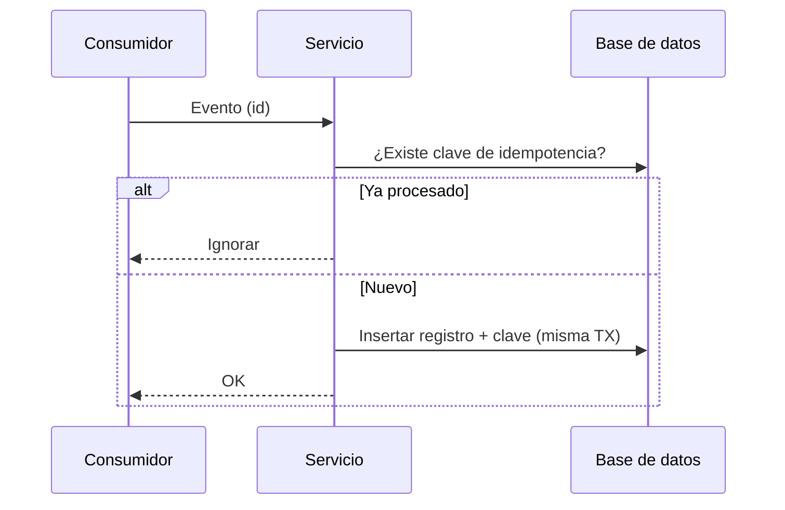

> Proyecto de ejemplo: reemplaza el contenido y el enlace `repo` por los reales.

## Problema

Un consumidor de mensajes puede recibir el mismo evento más de una vez. Sin una restricción de
unicidad en la tabla destino, ¿cómo evitamos insertar duplicados?

## Decisiones de arquitectura

- Registro de claves de idempotencia por evento.
- Verificación y escritura dentro de la misma transacción.

## Diagrama

